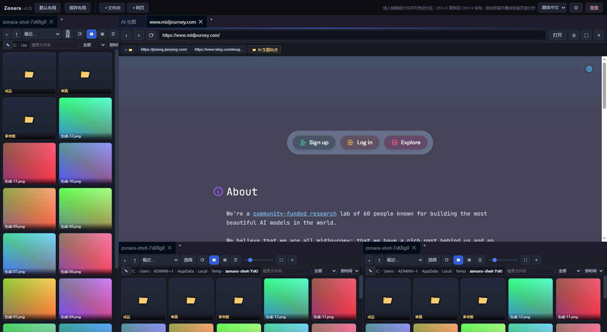
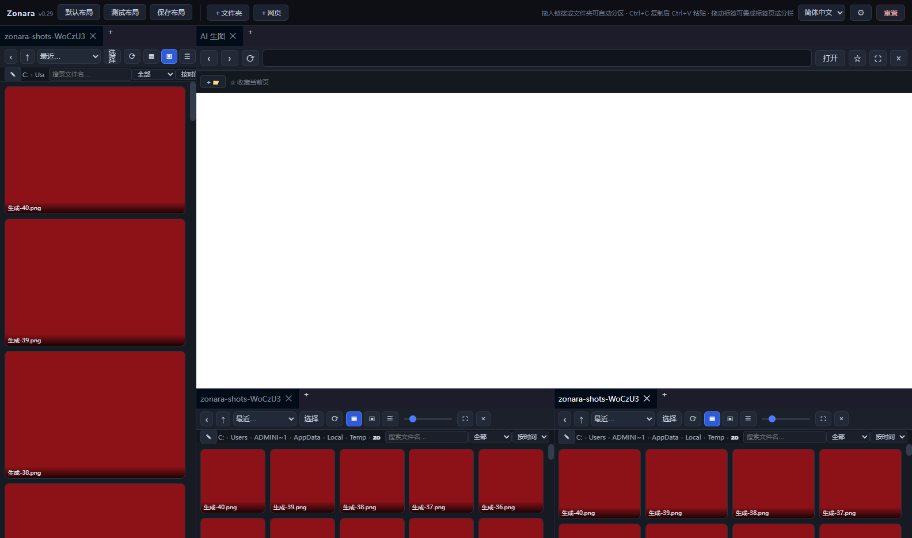
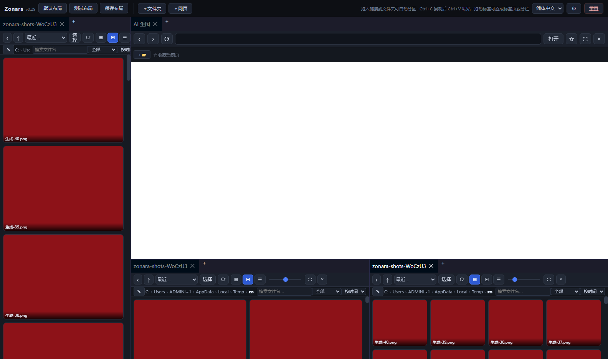
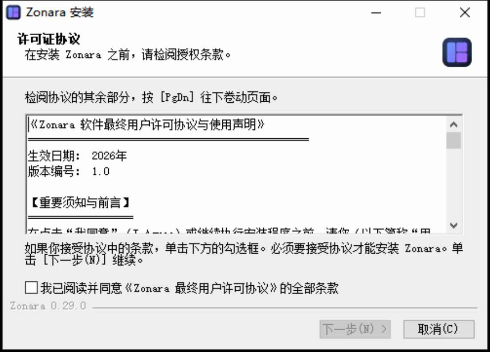

# Zonara

**可自由分区、拖入即吸附的 AI 生图多面板工作台**

Windows 10 / 11 · x64 · 当前版本 0.29.0

[**下载最新版**](../../releases/latest)

---

## 这是什么

Zonara 是一个面向 AI 绘图工作流的桌面工作台。它把「内嵌浏览器」「本地文件夹」「图片预览」放进同一块可自由切分的画布，
让你在一个窗口里翻提示词、看素材、对比生成结果，不必在十几个窗口之间来回切换。

## 核心特性

### 拖进来就分好区

- 从浏览器拖**链接**进窗口 → 自动新建浏览器分区并打开
- 从资源管理器拖**文件夹**进来 → 自动新建文件夹分区
- 拖到面板**边缘** → 在该侧切出新分区；拖到**中间** → 并入该面板成为标签页
- 拖拽时蓝色高亮框实时提示落点，整个窗口出现虚线框与「松开即可导入」提示

### 布局可保存、可还原

- 内置默认布局：左侧生成图 · 右上浏览器 · 右下素材
- 当前排列可命名保存，**连同各面板的目录、网址、预览方式一起记住**
- 布局按钮直接排在顶部，右键可删除（带二次确认）

### 看图顺便看参数

- 自动读取 PNG 内嵌元数据，卡片右上角 **i** 一键查看
- 支持 **AUTOMATIC1111 / WebUI** 与 **ComfyUI**：正向/负向提示词、Steps、Sampler、CFG、Seed、Size、Model、LoRA…
- 一键「复制提示词」，换个模型再来一张

### 素材管理

- 搜索（文件名 + 标签）、筛选（收藏 / 评分 / 标签）、排序（时间 / 名称 / 大小 / 类型）
- 收藏 ★、5 星评分、自定义标签，卡片角标直接显示
- 多面板实时同步：一处改动，另一处同一张卡片立刻跟着变，滚动位置不动

### 键盘流

- 方向键网格移动 · `Enter` 打开 · `空格` 大图预览 · `Backspace` 上一层
- `Ctrl+F` 搜索 · `F2` 重命名 · `Ctrl+C/X/V` · `Delete` 进回收站

## 下载与安装

前往 [Releases](../../releases/latest) 下载：

| 文件 | 说明 |
| --- | --- |
| `Zonara-Setup-<版本>.exe` | 安装版，写入开始菜单与桌面快捷方式，可正常卸载 |
| `Zonara-<版本>-便携版.exe` | 便携版，免安装，双击即用 |

> 安装向导要求**勾选「我已阅读并同意许可协议」**后才能继续，请先阅读 [EULA.md](EULA.md)。
> Windows 可能提示「未知发布者」，这是因为安装包未做商业代码签名。

## 系统要求

- Windows 10 / 11，64 位
- 建议 4 GB 以上内存

## 许可与版权

**本软件是专有软件，不是开源软件。**

项目标识 `ZNR-2026-AQ7F3-K9D2` · Copyright (c) 2026. All Rights Reserved.

- 仅授予**个人非商业使用**权
- 禁止转售、改名再发布、修改衍生及任何商业用途
- 完整条款见 [LICENSE](LICENSE)，最终用户协议见 [EULA.md](EULA.md)
- 第三方组件（Electron / dockview-core / koffi）适用其各自许可，见 [NOTICE](NOTICE)

软件内嵌显性与隐性数字水印及唯一构建标识，用于追溯副本来源。

---

本仓库仅用于**发布与下载**，不包含源代码。
